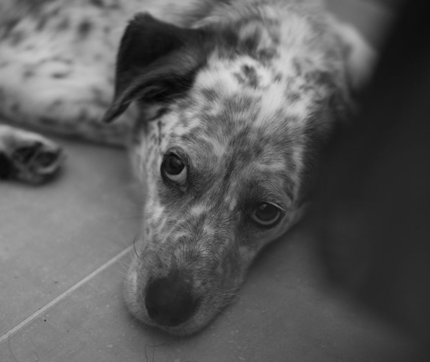
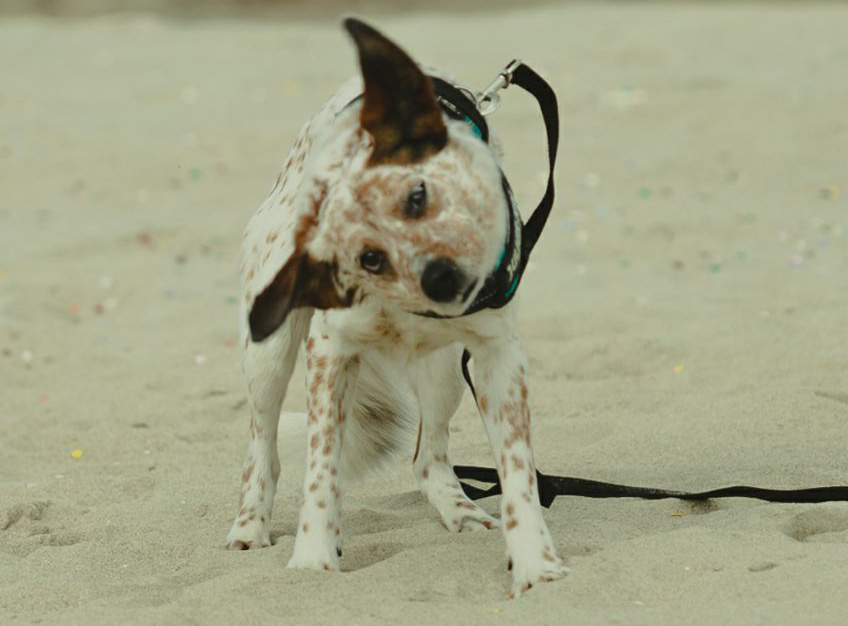
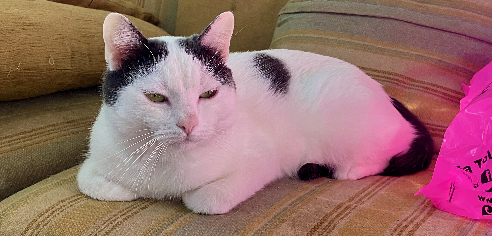

+++
date = '2026-10-24T12:09:27+02:00'
draft = false
title = 'I miei piccoli Astro e Renoir'
summary = ''
+++
Astro è il mio amico a quattro zampe che ho deciso di prendere durante la fase iniziale del covid. Dopo aver visto delle foto di alcuni amici non potevo non adottarlo, con quelle orecchie tenerissime e quello sguardo da cane bastonato.

Mentre scrivo questo testo, si trova in mezzo alle gambe seduto sul mio piede. È un cagnolino fobico: nonostante diversi incontri con educatori cinofili e tanta pazienza, alcune cose lo spaventano ancora; ma va bene così.

Prima di lui, per ben quindici anni, la mia piccola Beauty è stata la compagna della mia infanzia, adolescenza e anche di più. Dopo di lei desideravo trovare un altro amico peloso.

Renoir invece è il gatto che ogni mattina e ogni sera fa la pasta con le sue zampette bianche sulla mia pancia. Il suo sguardo è perennemente questo (quando non vuole mangiare e non sta dormendo):

Non è un micio cattivo, anzi, devo dire che è estremamente affettuoso e mi ha fatto capire e guardare con occhi diversi il mondo felino. Ero fermamente convinto che i gatti fossero esseri altezzosi e che non dessero mai confidenza. Invece quando sono seduto in bagno a riflettere, lui cerca le coccole spingendo la sua testolina carina contro il dorso e le dita della mia mano.

Spero di riuscire a dare loro quello di cui hanno bisogno nella loro vita, perché a modo loro riescono a rendere migliore la mia.