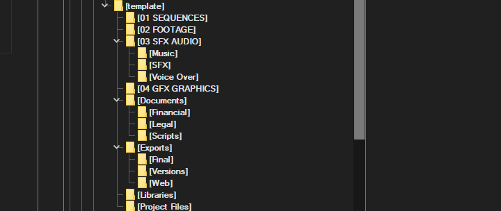

+++
date = '2026-10-30T22:30:29+01:00'
draft = false
title = 'Il segreto per organizzare le cartelle in un progetto video'
summary = 'Come organizzare le cartelle di un progetto video, dalle sequenze ai file esportati, per lavorare in ordine e ritrovare tutto subito.'
+++

Un progetto video cresce in fretta: footage, audio, grafiche, documenti ed esportazioni finiscono diventare un accozzaglia di file se non si parte da una struttura organizzata. Una struttura di cartelle ben pensata, copiata all'inizio di ogni nuovo lavoro, fa risparmiare un sacco di tempo.

Di seguito la struttura che uso come base per ogni progetto.

## La cartella template

Tutto parte da una cartella **template**, che contiene le sottocartelle standard. Ogni nuovo video viene creato copiandola e rinominandola in un formato tipo 26.10.29 NOME CLIENTE TIPO VIDEO: così la struttura è sempre la stessa e non va reinventata ogni volta.

## Sequenze e footage

- **01 SEQUENCES**: le sequenze di montaggio, cioè i progetti di editing veri e propri, in alcuni software si chiamano Timeline.
- **02 FOOTAGE**: le riprese originali, lasciate intatte e mai modificate. A volte organizzo sottocartelle in base alla videocamera o al formato di registrazione (orizzontale o verticale).

Tenere separati i girati dal montaggio evita di sovrascrivere per sbaglio il materiale di partenza.

## Audio

- **03 SFX AUDIO**, suddivisa in:
  - **Music**: musiche di sottofondo, con licenza e fonte annotate.
  - **SFX**: effetti sonori.
  - **Voice Over**: registrazioni di voce narrante.

## Grafica

- **04 GFX GRAPHICS**: loghi, titoli, animazioni e tutto ciò che è stato creato o adattato per il video.

## Documenti

Una cartella **Documents** raccoglie il materiale non multimediale:

- **Financial**: preventivi, fatture e pagamenti legati al progetto.
- **Legal**: contratti, liberatorie e licenze.
- **Scripts**: sceneggiatura, scaletta e note di lavorazione.

## Esportazioni

La cartella **Exports** separa le versioni del video in base all'uso:

- **Final**: la versione definitiva approvata.
- **Versions**: le revisioni intermedie, utili per tornare indietro.
- **Web**: versioni compresse per la pubblicazione online.

## Librerie e file di progetto

Infine, due cartelle di supporto:

- **Libraries**: librerie condivise, come preset, template e asset riutilizzabili.
- **Project Files**: i file di progetto del software di editing e i relativi backup.

## Conclusioni

Una struttura semplice e uguale per tutti i progetti rende il lavoro più prevedibile. Il consiglio principale è questo: scegli una struttura, documentala e rispettala fin dal primo giorno, adattandola solo quando serve davvero.
