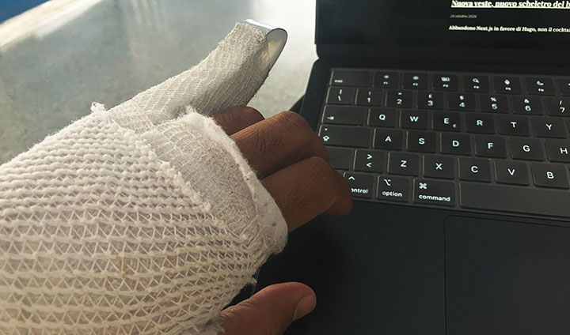

+++
date = '2026-11-08T14:01:47+01:00'
draft = false
title = 'Cosa è cambiato dopo la lesione al tendine del mignolo'
summary = 'Mi sono lesionato il tendine del mignolo dopo la doccia.'
+++

Qualche giorno fa sono riuscito a lesionare il tendine estensore del mignolo sinistro, stupidamente dopo la doccia. All'inizio non sembrava così grave, ma dopo i raggi e il responso dell'ortopedico: quaranta giorni di prognosi con la stecca, per vedere come si cicatrizza il tendine per poi fare fisioterapia.

Il lavoro al PC è cambiato, non potendo più usare il mignolino per premere CTRL o SHIFT ho dovuto mappare i tasti sui controlli secondari del mouse per velocizzare le operazioni: 25 anni di un movimento così basilare è difficile da cambiare.

Dovrò inoltre cambiare per questo periodo il piano e le modalità di allenamento per non peggiorare la situzione. Nel blog [Get SHREDDED or die trying](https://getshreddedordietrying.vincentveri.com/) racconto nel dettaglio il piano di allenamento adattato e questa piccola parentesi.

